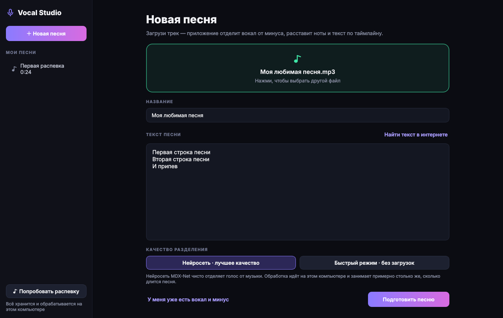

# Vocal Studio

Десктопный караоке-тренажёр на Python и Qt. Загружаешь песню — приложение отделяет вокал от минуса, расставляет ноты мелодии по таймлайну и показывает высоту твоего голоса в реальном времени. Справа идёт текст песни, как в Spotify.


## Что умеет

- **Разделение на вокал и минус** нейросетью MDX-Net (ONNX Runtime, без PyTorch). Работает на этом компьютере; модель (64 МБ) скачивается один раз при первой песне. Есть «быстрый режим» без нейросети и импорт готовых дорожек.
- **Ноты на таймлайне**: мелодия вокала превращается в блоки-ноты на пиано-ролле. Клик по таймлайну — перемотка.
- **Твой голос поверх нот**: линия высоты с микрофона; попал в ноту — она загорается зелёным, мимо — оранжевая линия и подсказка «выше/ниже». Считается процент попаданий.
- **Любая октава**: можно петь на октаву ниже или выше оригинала.
- **Текст справа от таймлайна**: текущая строка подсвечена, список плавно прокручивается, клик по строке — перемотка к ней.
  - обычный текст расставляется по мелодии автоматически (приблизительно);
  - LRC с метками `[00:12.50]` встаёт точно;
  - синхронный текст можно найти в интернете прямо из приложения (открытая база LRCLIB);
  - «Синхронизация»: включи песню и жми Пробел в начале каждой строки — остальные строки подстраиваются сами.
- Библиотека песен, громкость минуса и оригинального голоса, компенсация задержки, учебная распевка.

| Новая песня | Синхронизация текста |
| --- | --- |
|  |  |

## Запуск

### Windows

1. Установи **Python 3.10–3.13 (64-bit)** с python.org (с Python Launcher).
2. Запусти `setup-windows.bat` — создаст окружение и поставит зависимости.
3. Запусти `start.bat`.

Чтобы собрать самостоятельный `VocalStudio.exe`, запусти `build-windows.bat` (результат — `dist\VocalStudio\`).

### macOS / Linux

```bash
# Ubuntu / Debian: системные библиотеки для звука и Qt
sudo apt install libportaudio2 libxcb-cursor0 libegl1
```

```bash
# macOS
brew install portaudio
```

```bash
python3 -m venv .venv
```

```bash
.venv/bin/python -m pip install -e .
```

```bash
./start.sh
```

FFmpeg ставить отдельно не нужно — он приходит вместе с зависимостями (если в системе есть свой, используется он). Разреши приложению доступ к микрофону в настройках ОС.

## Как пользоваться

1. Для знакомства нажми **«Попробовать распевку»**.
2. **«Новая песня»** → перетащи файл (MP3, WAV, FLAC, M4A, OGG), при желании вставь текст → **«Подготовить песню»**. Нейросеть обрабатывает песню примерно за время её звучания (на CPU).
3. Надень наушники, нажми **«Включить микрофон»** и ▶. Фиолетовые блоки — ноты оригинала, зелёным загорается то, что ты спел в ноту.
4. Если линия голоса запаздывает относительно нот — увеличь **«Задержку»**.
5. Текст можно вставить или заменить в любой момент: **«Изменить»** на панели текста.

Клавиши: **Пробел** — играть/пауза (в режиме синхронизации — отметить строку), **← / →** — перемотка на 5 секунд.

## Хранение и приватность

Песни лежат в системной папке данных приложения (`VocalStudio/songs`), модель — рядом в `models`. Пути можно задать переменными `VOCALSTUDIO_LIBRARY` и `VOCALSTUDIO_MODELS`. Каждый проект — это `project.json`, `vocals.wav`, `instrumental.wav`, `reference.json`.

Аудио никуда не отправляется. В интернет приложение ходит только за моделью (один раз, с проверкой контрольной суммы) и за текстом, когда ты сам нажимаешь «Найти» — тогда отправляется только строка запроса.

## Устройство

| Модуль | Назначение |
| --- | --- |
| `vocalstudio/app.py` | окно, экраны, логика исполнения и синхронизации текста |
| `vocalstudio/widgets.py` | пиано-ролл, панель текста и остальные рисованные элементы |
| `vocalstudio/neural.py` | разделение MDX-Net: STFT/ISTFT на NumPy + ONNX Runtime |
| `vocalstudio/separation.py` | быстрый режим без нейросети (повторения + стереоцентр) |
| `vocalstudio/core.py` | высота тона (YIN), нарезка на ноты, LRC, авторасстановка текста |
| `vocalstudio/worker.py` | подготовка песни в отдельном процессе |
| `vocalstudio/audio.py` | воспроизведение и микрофон |
| `vocalstudio/lyrics_online.py` | поиск синхронного текста |

## Тесты

```bash
.venv/bin/python -m pip install -e '.[dev]'
```

```bash
QT_QPA_PLATFORM=offscreen .venv/bin/python -m pytest -q
```

## Ограничения

- Автоматическая расстановка обычного текста — оценка по мелодии (слоги ↔ ноты), а не распознавание речи. На длинных песнях строки могут уезжать; точный результат дают LRC или ручная синхронизация.
- Ноты строятся по основному голосу; бэк-вокал, дуэты и хрип могут давать лишние или неверные ноты.
- Быстрый режим заметно хуже нейросети и нужен как запасной вариант без интернета.
- Проверено в Linux: полный цикл на реальной записи, интерфейс, сборка PyInstaller. Живой микрофон, вывод звука, Windows/macOS и `build-windows.bat` в среде разработки не проверялись.
- Модель разделения — Kim Vocal 2 (MDX-Net) из открытого набора UVR; у неё собственные условия использования.
