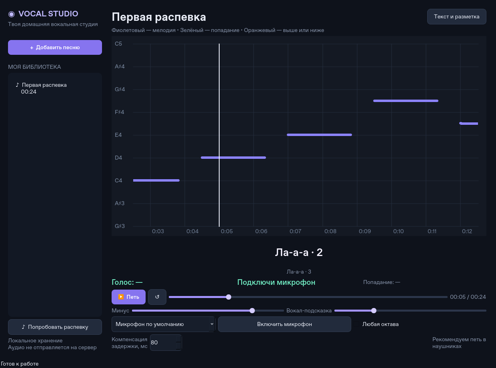
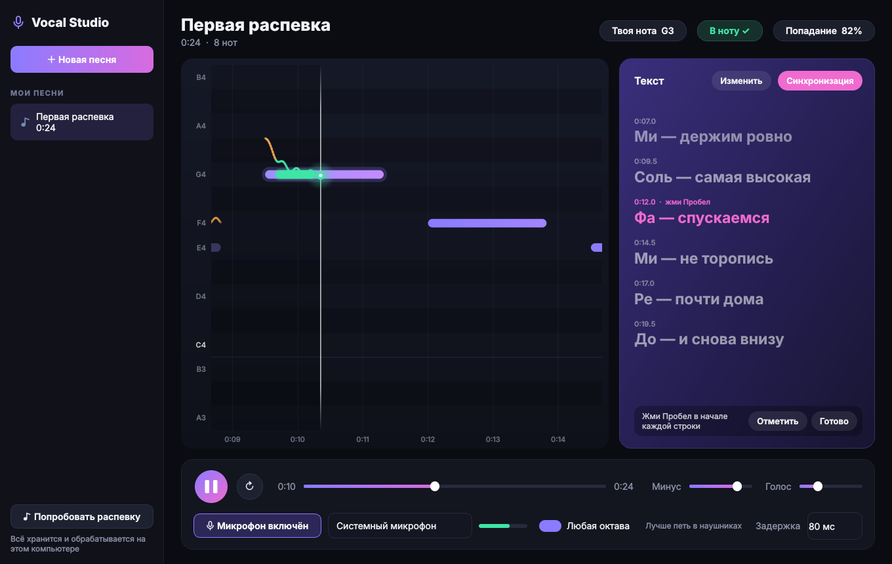
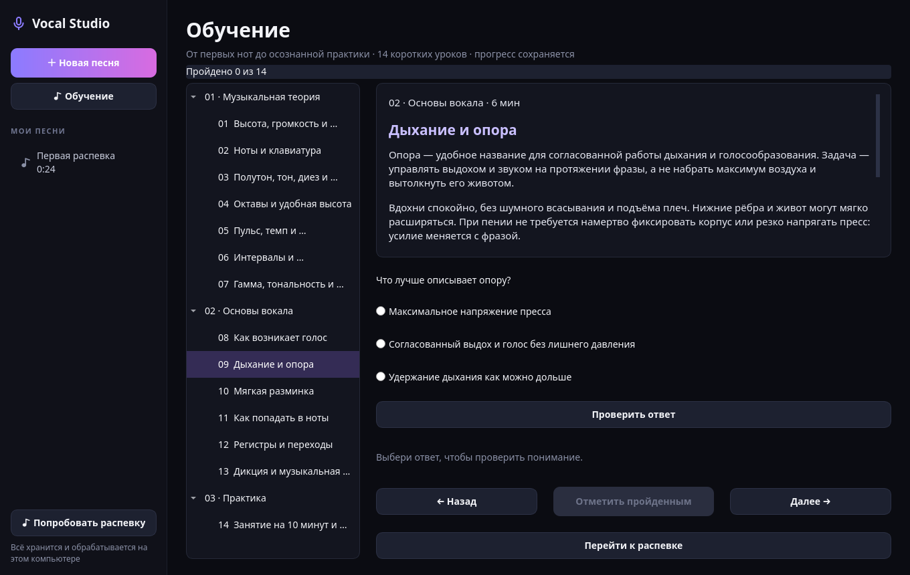

# Vocal Studio

Десктопный караоке-тренажёр на Python и Qt. Загружаешь песню — приложение отделяет вокал от минуса, расставляет ноты мелодии по таймлайну и показывает высоту твоего голоса в реальном времени. Справа идёт текст песни, как в Spotify.



## Что умеет

- **Разделение на вокал и минус** нейросетью MDX-Net (ONNX Runtime, без PyTorch). Работает на этом компьютере; модель (64 МБ) скачивается один раз при первой песне. Есть «быстрый режим» без нейросети и импорт готовых дорожек.
- **Ноты на таймлайне**: мелодия вокала превращается в блоки-ноты на пиано-ролле. Клик по таймлайну — перемотка.
- **Твой голос поверх нот**: линия высоты с микрофона; попал в ноту — она загорается зелёным, мимо — оранжевая линия и подсказка «выше/ниже». Считается процент попаданий.
- **Любая октава**: можно петь на октаву ниже или выше оригинала.
- **Текст справа от таймлайна**: текущая строка подсвечена, список плавно прокручивается, клик по строке — перемотка к ней.
  - обычный текст расставляется по мелодии автоматически (приблизительно);
  - LRC с метками `[00:12.50]` встаёт точно;
  - синхронный текст можно найти в интернете прямо из приложения (открытая база LRCLIB);
  - «Синхронизация»: включи песню и жми Пробел в начале каждой строки — остальные строки подстраиваются сами.
- **Обучение**: 14 уроков в трёх разделах — музыкальная теория, основы вокала и практика. Текст, упражнения, звуковые примеры и вопросы; прогресс сохраняется.
- Библиотека песен, громкость минуса и оригинального голоса, компенсация задержки, учебная распевка.

| Новая песня | Синхронизация текста |
| --- | --- |
|  |  |

## Запуск

### Windows: EXE и ярлык

В GitHub открой **Actions → Windows installer → успешная сборка → Artifacts → VocalStudio-windows-x64** и скачай архив. Для скачивания артефактов GitHub нужна авторизация.

- Запусти `VocalStudio-Setup-0.3.0-windows-x64.exe`. Установщик ставит приложение в папку текущего пользователя без прав администратора и создаёт ярлык в меню «Пуск». Пункт «Создать значок на рабочем столе» включён по умолчанию.
- Затем открывай **Vocal Studio** через ярлык. Python и отдельная установка FFmpeg не нужны.
- Альтернатива без установки: распакуй `VocalStudio-0.3.0-windows-x64.zip` целиком и запусти `VocalStudio/VocalStudio.exe`. Папка `_internal` должна оставаться рядом с EXE.
- Удаление — через список установленных приложений Windows; песни и прогресс в папке данных пользователя сохраняются.

Сборка рассчитана на Windows 10/11 x64 и пока не имеет цифровой подписи издателя.

### Сборка EXE из исходников на Windows

1. Установи Python 3.12 x64 и запусти `setup-windows.bat`.
2. Установи **Inno Setup 6** для создания установщика.
3. Запусти `build-windows.bat`. Скрипт соберёт приложение, проверит запуск GUI и фонового обработчика, затем создаст установщик и portable ZIP в `dist/`.
4. Если нужен только portable EXE без установщика: `build-windows.bat -SkipInstaller`.

Для разработки можно запускать `start.bat`. Сборка Windows выполняется на Windows, а не кросс-компиляцией в Linux. GitHub Actions также проверяет установку, цели ярлыков, запуск установленного приложения и удаление.

### macOS / Linux

```bash
# Ubuntu / Debian: системные библиотеки для звука и Qt
sudo apt install libportaudio2 libxcb-cursor0 libegl1
```

```bash
# macOS
brew install portaudio
```

```bash
python3 -m venv .venv
```

```bash
.venv/bin/python -m pip install -e .
```

```bash
./start.sh
```

FFmpeg ставить отдельно не нужно — он приходит вместе с зависимостями (если в системе есть свой, используется он). Разреши приложению доступ к микрофону в настройках ОС.

## Как пользоваться

1. Для знакомства нажми **«Попробовать распевку»**.
2. **«Новая песня»** → перетащи файл (MP3, WAV, FLAC, M4A, OGG), при желании вставь текст → **«Подготовить песню»**. Нейросеть обрабатывает песню примерно за время её звучания (на CPU).
3. Надень наушники, нажми **«Включить микрофон»** и ▶. Фиолетовые блоки — ноты оригинала, зелёным загорается то, что ты спел в ноту.
4. Если линия голоса запаздывает относительно нот — увеличь **«Задержку»**.
5. Текст можно вставить или заменить в любой момент: **«Изменить»** на панели текста.

Клавиши: **Пробел** — играть/пауза (в режиме синхронизации — отметить строку), **← / →** — перемотка на 5 секунд.

## Обучение

Кнопка **«Обучение»** слева открывает курс. Уроки доступны в любом порядке; рекомендуемый путь — сверху вниз:

1. **Музыкальная теория:** высота/тембр/громкость, ноты и клавиатура, тоны и полутоны, октавы, ритм, интервалы, тональности и аккорды.
2. **Основы вокала:** образование голоса, дыхание и опора, разминка, попадание в ноты, регистры, дикция и фразировка.
3. **Практика:** занятие на 10 минут, отдых и признаки перегрузки голоса.

Прочитай материал, выполни комфортное упражнение и ответь на вопрос. После верного ответа доступна кнопка «Отметить пройденным». Прослушивание примеров не обязательно для прохождения. Кнопка «Перейти к распевке» открывает упражнение. Переход в обучение ставит песню на паузу и выключает микрофон. Курс и звуковые примеры работают офлайн; это начальный учебный материал, без обещаний оценить здоровье голоса.



## Хранение и приватность

Песни лежат в системной папке данных приложения (`VocalStudio/songs`), модель — рядом в `models`. Пути можно задать переменными `VOCALSTUDIO_LIBRARY` и `VOCALSTUDIO_MODELS`. Прогресс курса и последний открытый урок сохраняются в `songs/settings.ini`. Каждый проект — это `project.json`, `vocals.wav`, `instrumental.wav`, `reference.json`.

Аудио никуда не отправляется. В интернет приложение ходит только за моделью (один раз, с проверкой контрольной суммы) и за текстом, когда ты сам нажимаешь «Найти» — тогда отправляется только строка запроса.

## Устройство

| Модуль | Назначение |
| --- | --- |
| `vocalstudio/app.py` | окно, экраны, логика исполнения и синхронизации текста |
| `vocalstudio/widgets.py` | пиано-ролл, панель текста и остальные рисованные элементы |
| `vocalstudio/neural.py` | разделение MDX-Net: STFT/ISTFT на NumPy + ONNX Runtime |
| `vocalstudio/separation.py` | быстрый режим без нейросети (повторения + стереоцентр) |
| `vocalstudio/core.py` | высота тона (YIN), нарезка на ноты, LRC, авторасстановка текста |
| `vocalstudio/worker.py` | подготовка песни в отдельном процессе |
| `vocalstudio/audio.py` | воспроизведение и микрофон |
| `vocalstudio/lyrics_online.py` | поиск синхронного текста |
| `vocalstudio/curriculum.py`, `learning.py` | уроки, примеры и сохранение прогресса |
| `packaging/`, `.github/workflows/windows.yml` | EXE, установщик, ярлыки и проверка Windows-сборки |

## Тесты

```bash
.venv/bin/python -m pip install -e '.[dev]'
```

```bash
QT_QPA_PLATFORM=offscreen .venv/bin/python -m pytest -q
```

## Ограничения

- Автоматическая расстановка обычного текста — оценка по мелодии (слоги ↔ ноты), а не распознавание речи. На длинных песнях строки могут уезжать; точный результат дают LRC или ручная синхронизация.
- Ноты строятся по основному голосу; бэк-вокал, дуэты и хрип могут давать лишние или неверные ноты.
- Быстрый режим заметно хуже нейросети и нужен как запасной вариант без интернета.
- Локальные тесты GUI и обработки запускаются в Linux без аудиоустройств. Проверка Windows EXE и установщика выполняется отдельным workflow; ориентируйся на результат конкретной сборки. Живой микрофон, аппаратный вывод звука и macOS требуют проверки на целевом устройстве.
- Модель разделения — Kim Vocal 2 (MDX-Net) из открытого набора UVR; у неё собственные условия использования.
